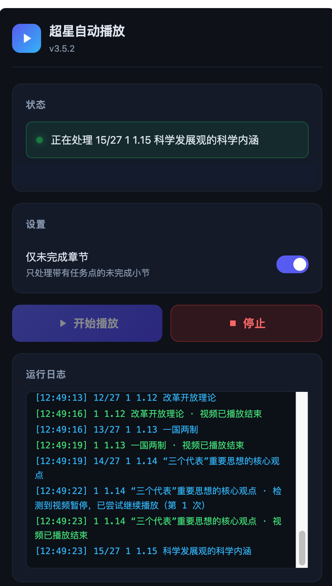
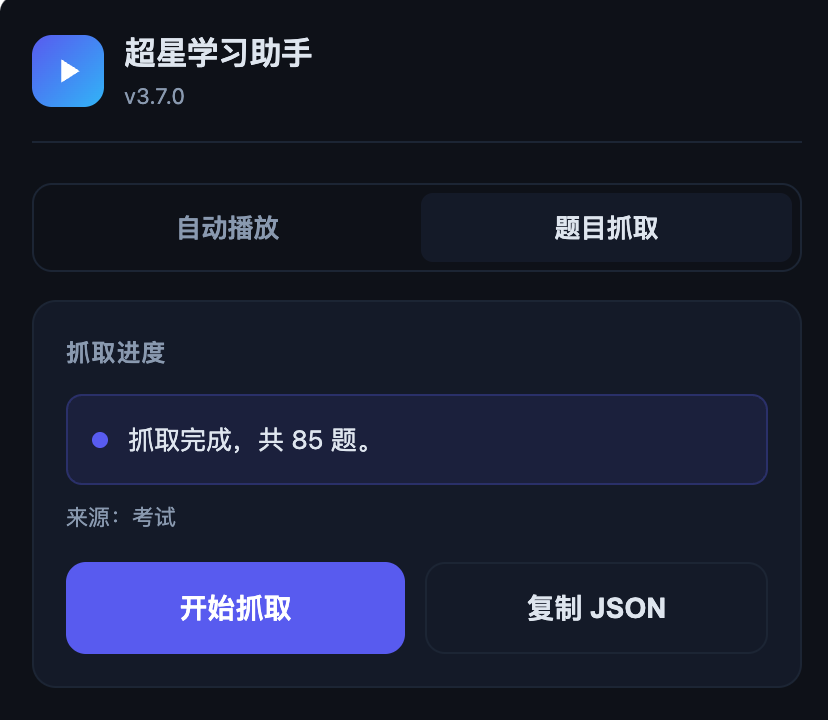

# 超星学习通助手 · Chaoxing Study Helper

一个用于超星学习通（Xuexitong）的 Chrome 浏览器扩展。在课程章节页用侧栏控制视频播放和课时切换，在题目页将题号、题干和选项文本一键复制为 JSON。适用于 Chrome 116 及以上版本，下载后即可本地加载。

**目录**　[安装](#安装) · [演示](#演示) · [自动播放](#自动播放) · [题目抓取](#题目抓取) · [权限与隐私](#权限与隐私) · [常见问题](#常见问题) · [关键词索引](#关键词索引) · [许可证](#许可证)

## 安装

1. **[下载最新版插件 ZIP](https://github.com/TheFern97941/chaoxing-helper/releases/latest/download/chaoxing-study-helper.zip)**，然后解压到一个准备长期保留的文件夹。也可以在[发行版列表](https://github.com/TheFern97941/chaoxing-helper/releases)下载指定版本。
2. 在 Chrome 地址栏打开 `chrome://extensions/`，开启「开发者模式」，点击「加载已解压的扩展程序」，选择刚才解压后包含 `manifest.json` 的文件夹。
3. 打开已登录的超星课程页，点击扩展图标「超星学习通自动播放助手」。在同一个侧栏切换「自动播放」和「题目抓取」。

更新时，下载最新版 ZIP，将文件解压覆盖到原安装目录，再到扩展管理页点击「重新加载」。

<details>
<summary>维护者如何发布新版本</summary>

首次将本项目推送到 `main` 后，GitHub Actions 会读取 `manifest.json` 的版本号，创建对应的发行版并附上安装包。后续发布时，更新该版本号并推送即可。也可以在 **Actions → Publish extension ZIP → Run workflow** 选择 `main` 手动运行。每个发行页都提供一个始终指向最新安装包的下载链接，适合分享到其他平台。

</details>

## 演示

### 自动播放与课时切换（12 秒）

点击播放，观察课时序号如何随播放队列向后递增。这段录屏来自早期版本。

https://github.com/user-attachments/assets/da19a0be-b0cd-4c4c-8978-8fb96df57837

### 题目抓取（5 秒）

录屏展示逐题读取时的进度。完成后，点击侧栏的「复制 JSON」即可复制结果。

https://github.com/user-attachments/assets/1f12475b-146f-498b-b6f2-8501b410b89a

<details>
<summary>查看播放日志和抓取完成后的界面截图</summary>

| 课程播放与课时切换 | 题目抓取与复制 |
| --- | --- |
|  |  |

</details>

## 自动播放

打开课程的「章节」页，在侧栏点击 **自动播放 → 开始播放**。日志显示当前课时、已结束的视频和跳过原因，点击「停止」会中止队列并暂停当前视频。

| 设置 | 生效范围 |
| --- | --- |
| 仅未完成章节 | 默认开启，只处理页面目录中标记为未完成的课时。 |
| 从当前选中课时开始 | 先在目录中选中课时，再启动队列。助手从这一课开始向后处理，也会应用上面的筛选条件。 |

播放器默认静音，允许定位时会尝试从末尾约 1.5 秒开始播放。意外暂停时，助手会尝试继续；连续 30 秒没有进度会跳过并记录原因。日志里的「播放结束」指播放器实际触发结束，课程任务点完成情况以学习页显示为准。

## 题目抓取

在超星打开要整理的题目，等待题干显示，再点击 **题目抓取 → 开始抓取**。整页展示的题目会一起读取；逐题展示时，扩展通过页面已有的答题卡或翻题按钮从首题开始读取。抓取期间保持侧栏和题目页面打开。

完成后点击 **复制 JSON**。每项的 `start` 是从 0 开始的题号，`content` 是题目区域的文本，包括页面中显示的题干和选项。下面是自行编写的示例数据。

```json
[
  {
    "start": 0,
    "content": "1. 哪种格式通常用来交换结构化数据？\nA. JSON\nB. PNG"
  }
]
```

切换侧栏功能时会保留本次结果。若手动停止或翻题失败，进度栏会显示已读取的数量，此时也能复制已有题目。[查看两道题的完整 JSON 示例](examples/questions.json)

## 权限与隐私

扩展在浏览器内处理课程页面。题目结果保存在侧栏内存中，关闭侧栏前请先复制。播放选项「从当前选中课时开始」保存在本机。侧栏显示的页面地址省略查询参数和片段。

| 权限 | 用途 |
| --- | --- |
| `sidePanel` | 在 Chrome 侧栏显示播放和题目工具。 |
| `tabs` | 将操作绑定到当前窗口的课程标签页。 |
| `webNavigation`、`scripting` | 在超星页面及嵌入框架中定位目录、播放器或题目，并执行用户点击的操作。 |
| `*://*.chaoxing.com/*` | 限定扩展可处理的网站。 |

## 常见问题

**侧栏提示没有题目。** 打开有题干和选项的具体页面，等内容加载后重试。课程首页、考试列表和须知页没有可读取的题目。

**已抓取部分题目，翻题时停止。** 可以先复制已取得的 JSON。检查网页上的题号或「下一题」能否正常使用，再重新开始。

**视频课时被跳过。** 在「运行日志」查看原因。阅读或测验课时、未加载出播放器的页面，以及连续 30 秒没有进度的视频都会记录跳过原因。

## 关键词索引

- 超星学习通、超星网课、Chaoxing、Xuexitong、Chrome 扩展安装 → [安装](#安装)
- 课程视频、自动播放、目录切换、从当前课时继续 → [自动播放](#自动播放)
- 学习通题目导出、题干和选项提取、答题卡、复制 JSON → [题目抓取](#题目抓取)

## 许可证

项目源码采用 MIT 许可证，复制或分发时请保留原版权声明和许可文本。超星、学习通为相应权利人的产品名称，本项目由社区独立维护。[MIT License](LICENSE)
